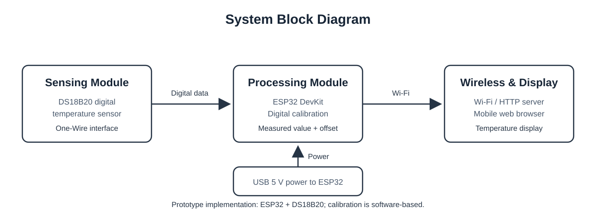

# Ultra-Low-Power CMOS Temperature Sensing Module with Integrated Digital Calibration and Wireless Communication

A budget-friendly ESP32-based temperature-monitoring prototype that reads a DS18B20 digital temperature sensor, applies a software calibration offset, and serves the temperature over Wi-Fi for viewing on a mobile browser.

> **Prototype scope:** The current hardware demonstrates digital temperature sensing, software-based calibration, and Wi-Fi monitoring. It uses an ESP32 DevKit and a DS18B20 sensor; it is not a custom CMOS temperature-sensor IC. Ultra-low-power performance has not yet been established through current-consumption measurements or a dedicated low-power operating-mode evaluation.

## System block diagram

The diagram shows the three functional modules:
1. **Sensing:** DS18B20 measures temperature and communicates over the One-Wire bus.
2. **Processing and calibration:** ESP32 reads the digital measurement and applies a configurable offset.
3. **Wireless communication and display:** ESP32 hosts an HTTP server over Wi-Fi; a phone on the same network opens the ESP32 IP address to view the reading.

## Hardware components

| Component | Quantity | Purpose |
|---|---:|---|
| ESP32 DevKit | 1 | Processing and Wi-Fi communication |
| DS18B20 waterproof temperature sensor | 1 | Digital temperature measurement |
| 4.7 kΩ resistor | 1 | One-Wire data-line pull-up |
| Breadboard | 1 | Prototyping |
| Male-to-male jumper wires | Approx. 10 | Breadboard connections |
| Male-to-female jumper wires | Approx. 10 | Sensor-to-board connections |
| USB cable | 1 | ESP32 power and programming |

## Wiring

| DS18B20 lead / part | ESP32 connection |
|---|---|
| VCC (typically red) | 3V3 |
| GND (typically black) | GND |
| DATA (typically yellow) | GPIO 4 |
| 4.7 kΩ resistor | Between DATA (GPIO 4) and 3V3 |

Wire colours can vary by sensor manufacturer. Confirm the sensor leadout before powering the circuit. The pull-up resistor is required on the One-Wire data line.

## Software requirements

- Arduino IDE
- ESP32 board support package
- OneWire library
- DallasTemperature library

## Upload and run

1. Install the ESP32 board package and select the matching ESP32 Dev Module board.
2. Install the **OneWire** and **DallasTemperature** libraries through Arduino Library Manager.
3. Open `src/temperature_monitor/temperature_monitor.ino`.
4. Replace the Wi-Fi SSID and password placeholders with the credentials for a **2.4 GHz Wi-Fi network**.
5. Confirm the sensor DATA wire is connected to GPIO 4.
6. Upload the sketch and open Serial Monitor at **9600 baud**.
7. Wait for the ESP32 to connect and print its IP address.
8. Connect the phone to the same Wi-Fi network and open `http://<ESP32-IP-address>` in a browser.

The current sketch refreshes the page every five seconds. The reading is therefore periodically updated (near-real-time monitoring), not a continuous high-rate stream.

## Digital calibration

The firmware applies a configurable software offset:

`Calibrated temperature = Measured temperature + Calibration offset`

The current sketch initializes the offset to `0.0 °C`. To calibrate, compare the sensor reading against a trusted reference thermometer under the same conditions, then set the offset to the reference reading minus the sensor reading. Record the reference instrument and test conditions when reporting calibration results.

## Firmware

The complete Arduino sketch is located at:

- [`src/temperature_monitor/temperature_monitor.ino`](src/temperature_monitor/temperature_monitor.ino)

## Project documentation

- [Wiring and component details](hardware/wiring.md)
- [Component list](hardware/components.md)
- [Algorithm](docs/algorithm.md)
- [System architecture](docs/system-architecture.md)
- [Design decisions](docs/design-decisions.md)
- [Testing checklist and observations](docs/testing.md)
- [Contribution and AI disclosure](docs/ai-disclosure.md)

## Current prototype observation

During the reported bench test, the mobile page displayed **27.56 °C**. This is an observed reading from that test session, not a guaranteed accuracy specification. Accuracy should be assessed against a calibrated reference thermometer over multiple temperatures.

## Limitations and future work

- Measure actual current consumption in active, idle, and any proposed sleep modes before claiming ultra-low-power performance.
- Evaluate sensor accuracy against a traceable reference over the intended operating range.
- Consider non-blocking sampling and a more responsive browser update method if required.
- A custom CMOS temperature-sensor implementation would require a separate IC-level design and characterization effort.

## Contributions and AI assistance

The project owner assembled and tested the physical ESP32/DS18B20 prototype, made the hardware connections, installed the development environment, uploaded the firmware, connected the device to Wi-Fi, and verified the mobile-browser temperature output.

AI assistance was used to help structure firmware and documentation, explain the One-Wire interface and calibration approach, and prepare repository documentation and the block diagram. The disclosure does not claim that AI performed the physical assembly or independent hardware validation.

## License

No license is declared yet. Add a license only after choosing and authorizing the terms under which others may use, modify, and distribute this repository.
